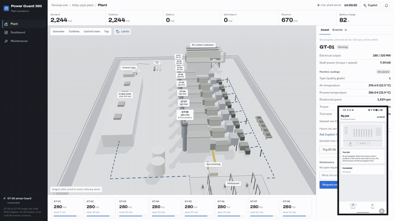
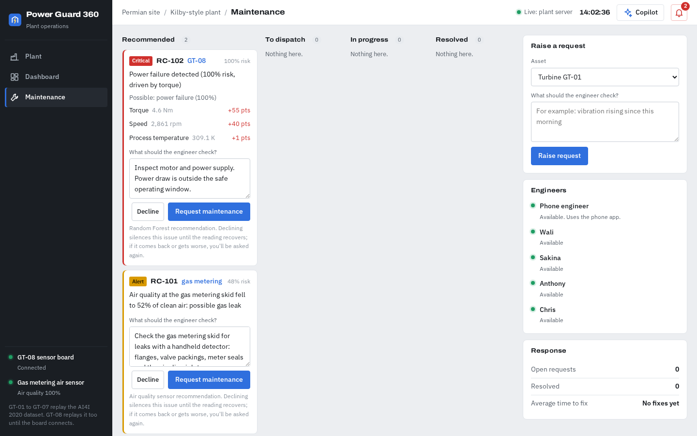
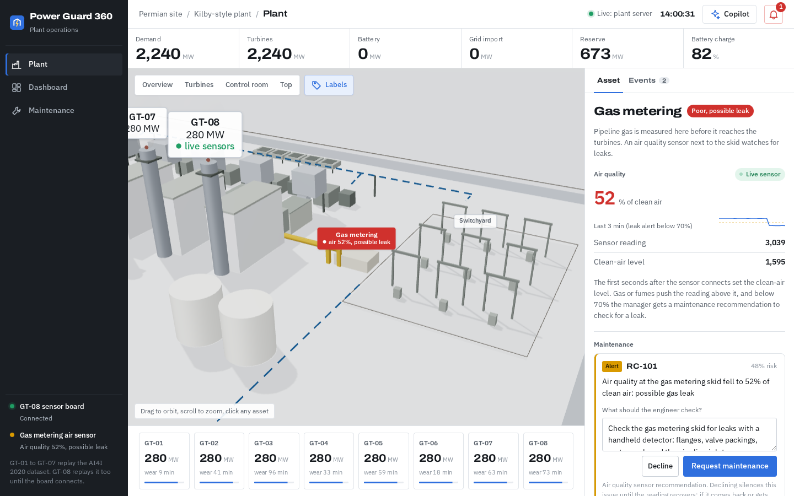
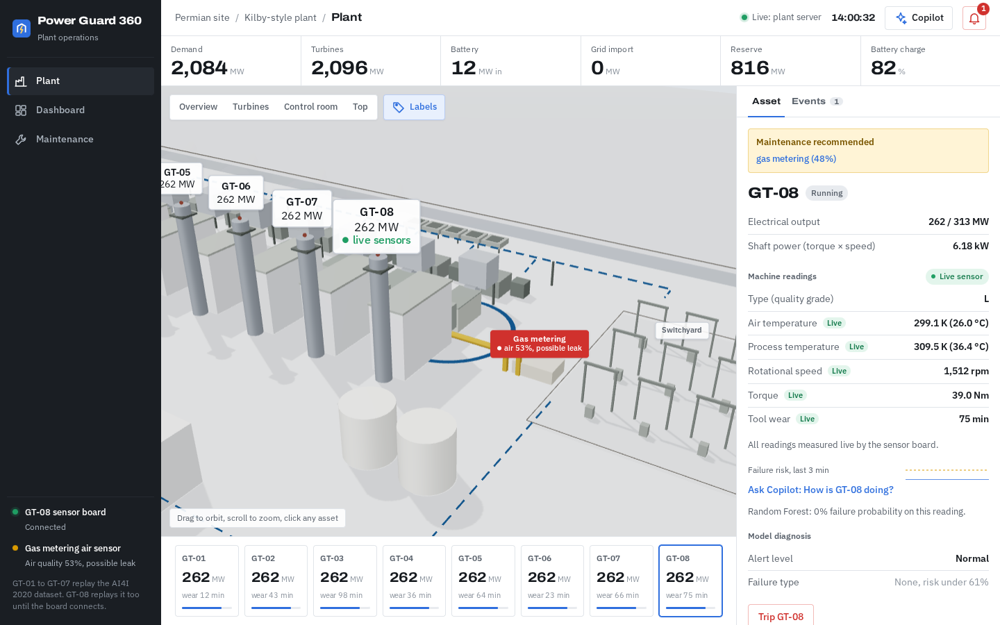
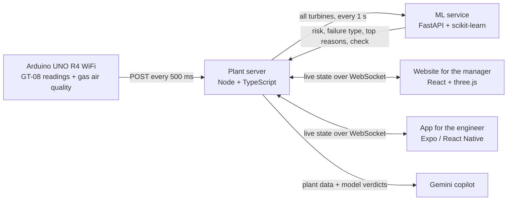

# Power Guard 360

**Predictive maintenance for a gas turbine plant that powers an AI data center.** A machine learning model watches every turbine's sensor data and tells the plant manager when a unit needs maintenance, why, and what to check. The manager decides, dispatches an engineer, and the engineer's phone takes them to the job. A live Arduino sensor board drives one turbine and watches the gas metering skid for leaks.

Built at CodeRED (University of Houston) for the Chevron track.

[](docs/media/demo.mp4)

[Watch the 2-minute demo video](docs/media/demo.mp4). It was recorded on an earlier build where turbines tripped and engineers were sent automatically; the screenshots below show the current flow.

| Maintenance recommendations | Gas leak alert |
|---|---|
|  |  |



## How it works



1. **Sense.** The board turns a hand-spun motor, a barometer and an air quality sensor into the six readings of the AI4I 2020 dataset and posts them twice a second. GT-08 runs on them live; the other seven turbines replay real dataset rows.
2. **Predict.** Every second the plant server sends all running turbines to the ML service. Model 1 (Random Forest, calibrated) gives the failure risk, Model 2 names the failure type, and SHAP gives the three readings that drove it.
3. **Recommend.** When the model flags a turbine, or air quality at gas metering drops below 70% of clean air, the manager gets a recommendation with the reasons and a suggested check.
4. **Decide.** The manager declines it, or requests maintenance with their own notes and dispatches a chosen engineer. Nothing reaches an engineer until then.
5. **Fix.** The engineer's phone buzzes with the job. They accept, walk to the asset (shake the phone to walk), and the repair starts on arrival, all visible live on the 3D map.

## The models

Two Random Forests trained on the [AI4I 2020 Predictive Maintenance dataset](https://archive.ics.uci.edu/dataset/601/ai4i+2020+predictive+maintenance+dataset) (10,000 readings), evaluated on 2,000 rows they never saw:

| Model | Job | Result |
|---|---|---|
| Failure detection | Will this machine fail? Calibrated risk, alert at 0.61 | 96% precision, 78% recall (53 of 68 failures, 2 false alarms), PR-AUC 0.90 |
| Failure type | Heat dissipation, power, overstrain or tool wear | macro F1 0.93 on real failures |

Logistic regression (PR-AUC 0.50) and XGBoost (0.88) were compared and lost. Full method, numbers and limits: [machine_learning/README.md](machine_learning/README.md).

## Stack

| Part | Built with |
|---|---|
| Website | React 19, TypeScript, Vite, three.js with React Three Fiber, Zustand |
| Engineer app | Expo, React Native, Expo Router |
| Plant server | Node.js, TypeScript, WebSockets (`ws`), Zod validation |
| ML service | Python, FastAPI, scikit-learn, SHAP, pandas |
| Copilot | Google Gemini |
| Hardware | Arduino UNO R4 WiFi, Grove Base Shield, barometer, R280 motor, Grove Air Quality Sensor |
| Tests | Vitest (web, server), pytest (ML) |

One plant engine (`web/src/sim/engine.ts`) is a pure function shared by the server, the website and the app, so every screen shows the same plant.

## Repository

| Folder | What it is |
|---|---|
| `web/` | Website and the shared plant engine in `web/src/sim/`. |
| `server/` | Plant server: runs the plant, takes sensor readings, asks the ML service for predictions, pushes live state to every screen, hosts the copilot. |
| `machine_learning/` | Both models, the training pipeline, the evaluation report, and the FastAPI service (`api.py`). |
| `mobile/` | Engineer app (Expo, Android). |
| `firmware/` | What the sensor board sends, and the board simulator. |
| `ml/` | What an external ML laptop can post to the server (optional). |
| `data/` | AI4I 2020 dataset and the fallback decision tree used when the ML service is down. |
| `docs/media/` | Demo video and screenshots. |

## Quick start

```
./deploy.sh
```

Starts the ML service, plant server, website and phone app on one laptop. Needs `server/.env` (tokens and the Gemini key, not in git). Details below.

## Running the demo

One laptop hosts everything. Everyone joins the same phone hotspot, which also gives internet for the copilot and avoids venue Wi-Fi.

```
                 Phone hotspot (internet for Gemini)
        ┌──────────────────┬──────────────────┬───────────────────┐
        │                  │                  │                   │
  HOST LAPTOP           ML LAPTOP        ENGINEER PHONE       JUDGE / extra screen
  plant server :8787    (optional)       Expo app             browser
  ML service   :8790    posts its own    (USB to host, or     http://<host-ip>:5180
  website      :5180    forecasts        Wi-Fi to :8787)
  board sim
```

Quick start on the host laptop, once `server/.env` is in place:

```
./deploy.sh            # opens the firewall ports, starts the ML service, plant server and website, forwards the USB phone, then runs Expo
./deploy.sh --no-ml    # same without the ML service
```

Ctrl+C stops everything. Logs are in `.logs/`. The steps below are what it does, for running pieces by hand.

### 1. Host laptop

Join the hotspot and find the laptop's address:

```
ip -4 addr | grep inet
```

If a firewall is on, open the ports:

```
sudo ufw allow 8787/tcp
sudo ufw allow 5180/tcp
```

One-time setup of the ML service (Python 3.11 or newer):

```
cd machine_learning && python3 -m venv .venv && .venv/bin/pip install -r requirements-api.txt
```

Start each in its own terminal, the ML service first:

```
cd machine_learning && .venv/bin/uvicorn api:app --host 127.0.0.1 --port 8790 --no-access-log   # ML service
cd server && npx tsx --env-file=.env src/server.ts     # plant server, port 8787
cd web && npx vite --host --port 5180                  # website
cd server && npm run board -- HDF                      # sensor board simulator
```

`server/.env` holds `DEVICE_TOKEN`, `MODEL_TOKEN` and `GEMINI_API_KEY`. It is not in git; get it from Wali.

The plant server prints `[ml] scoring every turbine with Random Forest` once it reaches the ML service. Every second it sends each running turbine's six readings to `machine_learning/api.py`, which answers with Model 1's failure risk, Model 2's failure type, the three inputs that moved the risk most (SHAP) and the maintenance action. The website and phone label those forecasts "Random Forest". A unit the model flags gets one recommendation, which stays on the board until the manager requests or declines it; declining silences that issue until the unit reads normal for 3 seconds, after which any new issue, or the same one getting clearly worse, is recommended again. A repaired unit stays quiet for 2 minutes. If the ML service stops, the server goes back to the built-in decision tree after 15 seconds. `ML_SERVICE_URL` changes the address; `ML_SERVICE_URL=off` skips it.

For the demo, use `-- PWF` or `-- OSF`: the model flags every recorded power and overstrain failure. The `-- HDF` row is one of the 5 heat failures out of 115 it misses (46% risk), and it misses most tool wear failures (see `machine_learning/README.md`).

The board simulator sends real AI4I rows once a second in the board's format. `npm run board` gives steady readings with clean air at gas metering; `-- GAS` drops the air quality 20 s in to show a leak; `-- HDF`, `-- OSF`, `-- PWF` or `-- TWF` plays 40 rows leading into a recorded failure, which the model should flag as a recommendation for GT-08. To also send each reading to the ML laptop:

```
ML_URL=http://<ml-ip>:<port>/<path> npm run board -- HDF
```

### 2. Website

- On the host: http://localhost:5180
- Any device on the hotspot: `http://<host-ip>:5180`

The top bar shows "Live: plant server" once it is connected.

### 3. Engineer phone

USB (most reliable):

```
cd mobile && npx expo start --lan
adb reverse tcp:8081 tcp:8081
adb reverse tcp:8787 tcp:8787
```

Then open the app in Expo Go.

Wi-Fi only:

```
cd mobile && EXPO_PUBLIC_WS_URL=ws://<host-ip>:8787/ws npx expo start --lan
```

Scan the QR code in Expo Go. The phone giving the hotspot can be the engineer phone too.

### 4. ML laptop

Optional now that the ML service runs on the host. A laptop that posts to `http://<host-ip>:8787/api/prediction` with `MODEL_TOKEN` overrides the ML service for its unit while it keeps posting. Format in `ml/README.md`.

### 5. Sensor board (Arduino UNO R4 WiFi)

The board joins the same hotspot and POSTs GT-08's six readings to the host once a second. Use it in place of `npm run board`.

```
POST http://<host-ip>:8787/api/ingest
Authorization: Bearer <DEVICE_TOKEN>
Content-Type: application/json

{"device":"plant-sensor-1","seq":1042,"uptime_ms":1042331,
 "readings":{"type":"M","air_temp_k":299.1,"process_temp_k":309.6,"rpm":1480,"torque_nm":43.2,"tool_wear_min":12}}
```

- `seq` goes up by one each send. Leave out a reading if its sensor fails; never send 0 or -1 as a fake value.
- Units and ranges for each field are in `firmware/README.md`. Out-of-range readings get a 400.
- 200 means accepted, 401 means the token is wrong.

Check the server takes readings before flashing the board:

```
curl -X POST http://<host-ip>:8787/api/ingest \
  -H "Authorization: Bearer <DEVICE_TOKEN>" -H "Content-Type: application/json" \
  -d '{"device":"test","seq":1,"uptime_ms":1,"readings":{"type":"M","air_temp_k":299.1,"process_temp_k":309.6,"rpm":1480,"torque_nm":43.2,"tool_wear_min":12}}'
```

The sketch is [`firmware/plant_sensor/plant_sensor.ino`](firmware/plant_sensor/plant_sensor.ino), for the **Arduino UNO R4 WiFi** (the R4 Minima has no Wi-Fi).

1. In the Arduino IDE install the "Arduino UNO R4 Boards" package and the "Seeed Arduino SPA06" library (barometer). `WiFiS3` comes with the board package.
2. Copy `firmware/plant_sensor/secrets.example.h` to `secrets.h` in the same folder and fill in the hotspot name and password, the host laptop's address and `DEVICE_TOKEN`. Git ignores `secrets.h`.
3. Open `plant_sensor.ino`, pick "Arduino UNO R4 WiFi" and upload.

Wiring, on a Grove Base Shield at 5 V:

| Port | Part | What it gives |
|---|---|---|
| I2C | Grove Barometer (SPA06-003) | air temperature |
| A2 | R280 motor spun by hand: one lead through 10 kΩ to the yellow wire, the other to black (GND) | speed |
| A3 | optional torque load circuit (`HAS_TORQUE 1`) | torque |
| A0 | Grove Air Quality Sensor v1.3, at the gas metering skid | air quality |

Without a torque sensor, torque comes from speed at constant power. Process temperature follows air temperature + 10 K with a lag, and tool wear counts up while the shaft turns.

Open Serial Monitor at 115200 baud: it stays quiet while posts succeed and prints the reply code and the body when one fails (401 wrong token, 400 bad body, 0 no reply). If the ML laptop needs the readings too, give it its own `WiFiClient` and repeat the post to its address.

To see exactly what the board sends, start the server with `LOG_INGEST=1 npx tsx --env-file=.env src/server.ts`. Every post is printed, and rejected ones say which field was wrong.

**Air quality at gas metering.** Plug the Grove Air Quality Sensor v1.3 into A0. After its 20 s warm-up the board adds `air_quality_raw` to every post. The server takes the first few seconds of readings as clean air and shows the rest as a percentage of it on the gas metering asset. Below 70% the manager gets a "possible gas leak" maintenance recommendation. For the presentation: let it settle in normal air, then cup your hands over the sensor and breathe into it. The reading climbs, quality drops and the recommendation appears within a couple of seconds. Without the board, `npm run board -- GAS` plays the same drop. If breathing doesn't bring it under 70%, lower `GAS_ALERT_PCT` in `web/src/sim/engine.ts`.

The board doesn't have to send all six readings. Whatever it sends drives GT-08 live (marked "Live" on the website); anything it leaves out keeps replaying from the dataset.

When it works, GT-08 shows "Live sensor" on the website within a second, and readings the model flags show up as a maintenance recommendation for GT-08.

### Before judging

- Plug in the host laptop and the hotspot phone. A hotspot drains a battery fast.
- The host's address can change if the hotspot restarts. Check `ip -4 addr` again and update the Wi-Fi phone.
- Check the plant server printed `[ml] scoring every turbine with Random Forest`.
- Do one full run: `npm run board -- PWF`, GT-08 recommendation on the maintenance board, edit what to check, Request maintenance, Dispatch to the phone engineer, alert on the phone, Accept, walk, website updates, repair.
- Backup: the Vercel link runs a local simulation when no server is reachable, so the 3D plant and dashboard still work without the hotspot.

### Showing it to someone off the hotspot

```
cloudflared tunnel --url http://localhost:8787
```

Open the website with `?ws=wss://<tunnel-host>/ws` added to the address. The tunnel address changes every run.

## Tests

```
cd web && npx vitest run && npx tsc -b
cd server && npx vitest run && npx tsc --noEmit
cd mobile && npx tsc --noEmit
cd machine_learning && .venv/bin/python -m pytest -q
```
